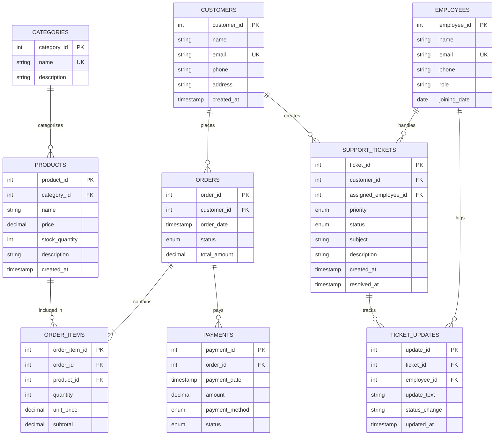

# Customer Relationship Management (CRM) System

A robust, enterprise-grade, console-based **Customer Relationship Management (CRM) System** developed in **C++17**, demonstrating practical software engineering fundamentals: **Object-Oriented Design**, **Standard Template Library (STL)**, **Data Structures & Algorithms (Queue / Priority Queue)**, and **Relational Database Management Systems (MySQL with ACID Transactions & Prepared Queries)**.

---

## 1. Project Overview & Problem Statement

Modern commercial enterprises require resilient systems to track customer accounts, manage employee support responsibilities, fulfill product orders atomically, and triage customer incidents based on strict service level agreements (SLAs).

This project implements a complete, decoupled, three-layer enterprise CRM engine communicating directly with a MySQL 8.0 database. The architecture is deliberately designed without web bloat or external framework overhead, enabling complete technical defense during software engineering placement interviews.

---

## 2. Core Functional Modules

### Module 1: Customer Management
- **Add Customer**: Validates input formats and prevents duplicate email registration.
- **Update Customer**: Updates customer contact and billing address records.
- **Delete Customer**: Enforces referential integrity checks (prevents deleting customers with historical orders or active tickets).
- **Search Customers**: Fast indexed lookup by Customer ID, partial Name, or Email address.
- **Display All Customers**: Formatted tabular view.
- **Customer History**: Consolidated 360-degree view of previous purchases and logged support tickets.

### Module 2: Employee Management
- **Employee Directory**: Tracks internal agents, roles, emails, phone numbers, and joining dates.
- **Search & Update**: Query and modify employee profile attributes.
- **Ticket Assignment**: Assigns technical representatives to open customer support issues.
- **Workload Monitoring**: Evaluates active vs resolved ticket counts per representative to prevent burnout.

### Module 3: Product Management
- **Catalogue Maintenance**: Add, update, and search commercial catalogue items with Category classification.
- **Inventory & Pricing Control**: Modify unit prices and real-time stock levels.
- **Stock Validation**: Rejects invalid quantities or negative pricing.
- **Low-Stock Alerting**: Automatic filtering of products with inventory $\le 10$ units.
- **Safe Deletion**: Restricts deletion of catalogue products referenced in order history.

### Module 4: Order Management & ACID Transactions
- **Multi-Product Orders**: Build orders with multiple line items, unit quantities, and automatic subtotal calculation.
- **ACID Database Transactions**: Order creation atomically executes:
  1. Header insertion into `orders`.
  2. Inventory deduction verification with optimistic locking in `products`.
  3. Line-item logging in `order_items`.
  4. Payment record generation in `payments`.
- **Automatic Rollback**: If available inventory is insufficient for any item or an operation fails, the transaction is immediately rolled back via RAII.
- **Order Cancellation**: Restores reserved inventory back to catalogue stock and marks payments as `REFUNDED`.

### Module 5: Support Ticket Management (DSA)
- **Urgent Priority Queue (`std::priority_queue`)**: Critical and High severity issues are handled via a custom comparator heap.
- **FIFO Standard Queue (`std::queue`)**: Normal and Low severity inquiries are processed in strict First-In, First-Out order.
- **Deterministic Comparator**: Enforces urgency-first ordering, with a FIFO tie-breaker ensuring older tickets (lower ID / creation timestamp) are resolved first.
- **Duplicate Prevention**: In-memory `std::unordered_set<int>` prevents duplicate enqueuing.
- **Database Synchronization**: Queues hydrate from MySQL on application startup and update ticket states (`OPEN` $\to$ `IN_PROGRESS` $\to$ `RESOLVED` $\to$ `CLOSED`) with full audit logs in `ticket_updates`.

### Module 6: Sales & Operational Analytics
- **Executive KPI Metrics**: Gross sales revenue, total completed orders, and Average Order Value (AOV).
- **Monthly Revenue Breakdown**: Aggregated trend analysis using SQL `DATE_FORMAT` and `GROUP BY`.
- **Top 5 VIP Customers**: Highest spenders calculated across orders.
- **Best-Selling Products**: Ranked by units sold and gross revenue contribution.
- **Employee Workload Distribution**: Active vs resolved ticket load per support agent.
- **Ticket Severity Matrix**: Multi-dimensional backlog breakdown by status and priority.

---

## 3. Technology Stack

- **Language**: C++17 (`std::unique_ptr`, `std::optional`, `<queue>`, `<unordered_set>`)
- **Database**: MySQL Server 8.0+ (InnoDB Engine with ACID compliance)
- **Database Connector**: Direct MySQL C Client API (`mysql.h`, `libmysql.lib`, `libmysql.dll`) wrapped in a custom C++ RAII manager
- **Build System**: CMake 3.16+ with Ninja / MinGW-w64 / MSVC toolchains
- **Version Control**: Git & GitHub

---

## 4. System Architecture

A clean **Three-Layer Decoupled Architecture**:

```
┌────────────────────────────────────────────────────────────────────────┐
│                      PRESENTATION LAYER (Layer 1)                      │
│   • MenuUI, ConsoleUtils (Safe CLI input, tables, user workflows)       │
└───────────────────────────────────┬────────────────────────────────────┘
                                    │ Invokes
┌───────────────────────────────────▼────────────────────────────────────┐
│                     BUSINESS LOGIC LAYER (Layer 2)                     │
│   • CustomerService, EmployeeService, ProductService                   │
│   • OrderService (Inventory validation, subtotal calculation)          │
│   • TicketManager (std::queue & std::priority_queue coordination)      │
│   • AnalyticsService (Reporting metrics formatting)                    │
└───────────────────────────────────┬────────────────────────────────────┘
                                    │ Coordinates
┌───────────────────────────────────▼────────────────────────────────────┐
│                      DATA ACCESS LAYER (Layer 3)                       │
│   • DatabaseManager (RAII connection pooling, transactions)           │
│   • Repositories (CustomerRepo, ProductRepo, OrderRepo, TicketRepo...) │
│   • Parameterized queries, SQL escaping, Result set mapping            │
└───────────────────────────────────┬────────────────────────────────────┘
                                    │ Executes SQL
┌───────────────────────────────────▼────────────────────────────────────┐
│                            MySQL DATABASE                              │
│   • 9 Relational Tables (InnoDB, foreign keys, constraints, indexes)   │
└────────────────────────────────────────────────────────────────────────┘
```

---

## 5. Database Design & Entity-Relationship (ER) Diagram

The database schema is normalized to **Third Normal Form (3NF)** across exactly 9 core relational tables:



### Relationship Cardinality & Integrity Rules:
1. **Customers $\to$ Orders (`1 : N`)**: A customer can place multiple orders. Deletion of customers with existing orders is restricted (`ON DELETE RESTRICT`) to protect financial history.
2. **Customers $\to$ Support Tickets (`1 : N`)**: Customers can log multiple support tickets. Deletion restricted if open tickets exist.
3. **Employees $\to$ Support Tickets (`1 : N`)**: An employee can be assigned multiple tickets. If an employee is removed, `assigned_employee_id` is set to `NULL` (`ON DELETE SET NULL`) so tickets remain in queue.
4. **Categories $\to$ Products (`1 : N`)**: Each product belongs to one category. Deleting a populated category is restricted.
5. **Orders $\to$ Order Items (`1 : N`)**: An order contains one or more line items. Deleting an order cascades to its items (`ON DELETE CASCADE`).
6. **Products $\to$ Order Items (`1 : N`)**: A product can appear across multiple order line items. Deleting an ordered product is restricted.
7. **Orders $\to$ Payments (`1 : N`)**: Tracks payment and refund records for each order (`ON DELETE CASCADE`).
8. **Support Tickets $\to$ Ticket Updates (`1 : N`)**: Maintains an append-only audit trail of status changes and investigation notes (`ON DELETE CASCADE`).

---

## 6. Project Directory Structure

```
CRM-System/
├── CMakeLists.txt              # CMake build orchestration
├── .gitignore                  # Git exclusion rules
├── README.md                   # Comprehensive documentation & portfolio guide
├── config/
│   ├── db_config.example.ini   # Template configuration file
│   └── db_config.ini           # Local database credentials (git-ignored)
├── sql/
│   ├── schema.sql              # 9-table normalized schema with constraints & indexes
│   ├── seed.sql                # Realistic initial test dataset
│   └── queries.sql             # 16 production-grade analytical SQL queries
├── include/
│   ├── database/
│   │   ├── ConfigLoader.hpp    # INI file parser & environment variable reader
│   │   └── DatabaseManager.hpp # RAII connection pool & TransactionGuard
│   ├── models/
│   │   ├── User.hpp            # Abstract base class (Polymorphism & RAII)
│   │   ├── Customer.hpp        # Derived Customer entity
│   │   ├── Employee.hpp        # Derived Employee entity
│   │   ├── Category.hpp        # Product category model
│   │   ├── Product.hpp         # Product entity with inventory methods
│   │   ├── Order.hpp           # Order entity (Composition with OrderItem)
│   │   ├── OrderItem.hpp       # Line-item model
│   │   ├── Payment.hpp         # Payment transaction model
│   │   ├── SupportTicket.hpp   # Ticket model & TicketComparator
│   │   └── TicketUpdate.hpp    # Audit update model
│   ├── repositories/           # Layer 3: Data Access Layer
│   │   ├── CustomerRepository.hpp
│   │   ├── EmployeeRepository.hpp
│   │   ├── ProductRepository.hpp
│   │   ├── OrderRepository.hpp
│   │   ├── TicketRepository.hpp
│   │   └── AnalyticsRepository.hpp
│   ├── services/               # Layer 2: Business Logic Layer
│   │   ├── CustomerService.hpp
│   │   ├── EmployeeService.hpp
│   │   ├── ProductService.hpp
│   │   ├── OrderService.hpp
│   │   ├── TicketManager.hpp   # Queue & Priority Queue coordinator
│   │   └── AnalyticsService.hpp
│   └── ui/                     # Layer 1: Presentation Layer
│       ├── ConsoleUtils.hpp    # Input sanitization & formatting utilities
│       └── MenuUI.hpp          # Interactive CLI menus
├── src/
│   ├── database/
│   ├── repositories/
│   ├── services/
│   ├── ui/
│   └── main.cpp                # Application entry point
└── tests/
    └── test_runner.cpp         # Automated verification test suite
```

---

## 7. Object-Oriented Programming (OOP) Demonstration

| OOP Concept | Implementation Details | Code Reference |
| :--- | :--- | :--- |
| **Encapsulation** | Private attributes with validated accessors; business invariant enforcement | `Product::deductStock()`, `Product::hasStock()` |
| **Inheritance** | `Customer` and `Employee` inherit from abstract base `User` | [Customer.hpp](include/models/Customer.hpp), [Employee.hpp](include/models/Employee.hpp) |
| **Polymorphism** | Runtime dispatch via pure virtual `virtual void displayDetails() const = 0` and `virtual std::string getRole() const = 0` | [User.hpp](include/models/User.hpp#L38-L41) |
| **Abstraction** | Business services operate against repository interfaces without knowing underlying SQL | `OrderService` delegates to `OrderRepository` |
| **Composition** | An `Order` owns and manages an array of `OrderItem` objects (`std::vector<OrderItem>`) | [Order.hpp](include/models/Order.hpp#L23-L25) |
| **RAII** | Connections and transactions automatically clean up on exit/exception | `TransactionGuard` destructor issues `ROLLBACK` unless committed |

---

## 8. Data Structures & Algorithms: Queue & Priority Queue

### Why Both Queues?
Real-world customer operations have two competing demands:
1. **Urgent incidents (System Outages, Critical Security bugs)** must bypass standard requests and get resolved immediately.
2. **Routine inquiries (General billing, quotes)** must be treated equitably using standard FIFO ordering.

### Priority Queue (`std::priority_queue`) with Custom Comparator
Implemented in `TicketManager` for `CRITICAL` and `HIGH` severity tickets:
```cpp
struct TicketComparator {
    bool operator()(const SupportTicket& a, const SupportTicket& b) const {
        // 1. Higher priority first (CRITICAL = 1, HIGH = 2)
        if (a.getPriority() != b.getPriority()) {
            return static_cast<int>(a.getPriority()) > static_cast<int>(b.getPriority());
        }
        // 2. FIFO Tie-breaker: Older ticket (smaller ID / timestamp) comes first
        return a.getId() > b.getId();
    }
};
```

### Standard FIFO Queue (`std::queue`)
Used for `NORMAL` and `LOW` severity tickets, ensuring fair first-come, first-served treatment.

### Duplicate Prevention & DB Sync
- `std::unordered_set<int> queuedTicketIds` guarantees $O(1)$ duplicate checking.
- `TicketManager::syncFromDatabase()` hydrates unassigned/pending tickets from MySQL upon application start.
- When an employee calls `processNextTicket()`, urgent tickets pop first; when urgent is empty, normal tickets pop. Database state changes to `IN_PROGRESS` and records in `ticket_updates`.

---

## 9. Key Analytical SQL Queries (Summary)

The `sql/queries.sql` file includes 16 production-grade SQL queries. Highlights include:

1. **Gross Revenue & AOV**:
   ```sql
   SELECT COUNT(order_id) AS total_orders,
          COALESCE(SUM(total_amount), 0.00) AS total_revenue,
          COALESCE(ROUND(AVG(total_amount), 2), 0.00) AS average_order_value
   FROM orders WHERE status = 'COMPLETED';
   ```
2. **Top 5 Customers by Spending**:
   ```sql
   SELECT c.customer_id, c.name, COUNT(o.order_id) AS orders, SUM(o.total_amount) AS total_spent
   FROM customers c
   INNER JOIN orders o ON c.customer_id = o.customer_id
   WHERE o.status = 'COMPLETED'
   GROUP BY c.customer_id, c.name
   ORDER BY total_spent DESC LIMIT 5;
   ```
3. **Best-Selling Products by Revenue**:
   ```sql
   SELECT p.product_id, p.name, cat.name AS category, SUM(oi.quantity) AS units_sold, SUM(oi.subtotal) AS revenue
   FROM products p
   INNER JOIN categories cat ON p.category_id = cat.category_id
   INNER JOIN order_items oi ON p.product_id = oi.product_id
   INNER JOIN orders o ON oi.order_id = o.order_id
   WHERE o.status = 'COMPLETED'
   GROUP BY p.product_id, p.name, cat.name
   ORDER BY revenue DESC;
   ```
4. **Employee Ticket Workload Matrix**:
   ```sql
   SELECT e.employee_id, e.name, e.role,
          COUNT(t.ticket_id) AS total_assigned,
          SUM(CASE WHEN t.status IN ('OPEN', 'IN_PROGRESS') THEN 1 ELSE 0 END) AS active_tickets,
          SUM(CASE WHEN t.status IN ('RESOLVED', 'CLOSED') THEN 1 ELSE 0 END) AS resolved_tickets
   FROM employees e
   LEFT JOIN support_tickets t ON e.employee_id = t.assigned_employee_id
   GROUP BY e.employee_id, e.name, e.role
   ORDER BY active_tickets DESC;
   ```

---

## 10. Build & Execution Guide

### Prerequisites
- Modern C++17 Compiler (MinGW-w64 GCC 11+ or MSVC 2019+)
- CMake 3.16+
- MySQL Server 8.0+

### Step 1: Initialize Database & Sample Data
Open your MySQL terminal or MySQL Workbench:
```sql
SOURCE sql/schema.sql;
SOURCE sql/seed.sql;
```

### Step 2: Configure Credentials
Copy the example configuration file:
```bash
cp config/db_config.example.ini config/db_config.ini
```
Edit `config/db_config.ini` with your local MySQL password:
```ini
[database]
host = 127.0.0.1
port = 3306
database = crm_db
user = root
password = your_mysql_password
```

### Step 3: Build using CMake
```bash
# Configure build files
cmake -B build -G "Ninja"

# Build all targets (crm_system and crm_tests)
cmake --build build
```
*(The build system automatically copies `libmysql.dll`, `libssl-3-x64.dll`, and `libcrypto-3-x64.dll` to the binary directory).*

### Step 4: Run Automated Tests
```bash
./build/crm_tests
```
**Expected Output:**
```
========================================================
          CRM SYSTEM AUTOMATED TEST SUITE               
========================================================

>>> Running Test Group 1: OOP & Runtime Polymorphism <<<
  [PASS] Polymorphic getRole() returns 'Customer'
  [PASS] Polymorphic getRole() returns 'Lead Engineer'
  [PASS] Order total calculated correctly via OrderItem composition

>>> Running Test Group 2: DSA Queues & Priority Ordering <<<
  [PASS] Priority Queue correctly processes CRITICAL ticket before HIGH
  [PASS] Priority Queue FIFO tie-breaker: older HIGH ticket (ID 1) processed before newer (ID 3)
  [PASS] Remaining HIGH ticket (ID 3) processed last
  [PASS] Standard queue enforces strict First-In, First-Out (FIFO) ordering
  [PASS] Duplicate set tracks existing ticket ID
  [PASS] Duplicate ticket prevention logic accurately identifies already-queued ticket

>>> Running Test Group 3: Database Services & Transactions <<<
  [PASS] Database connected successfully
  [PASS] Customer registered successfully with positive database ID
  [PASS] Duplicate email registration prevented by CustomerService
  [PASS] Product added successfully with positive database ID
  [PASS] Product price updated in database
  [PASS] Negative product price rejected by ProductService validation
  [PASS] Order placed successfully via multi-table database transaction
  [PASS] Order placement with insufficient stock failed and triggered rollback
  [PASS] Order cancelled and inventory restored atomically via transaction
  [PASS] Support ticket created and synchronized to in-memory queue
  [PASS] Next ticket successfully popped from priority queue and assigned
  [PASS] Analytics total orders aggregation computed successfully
  [PASS] Analytics gross revenue aggregation computed successfully

========================================================
TEST SUMMARY: 21 PASSED, 0 FAILED.
========================================================
```

### Step 5: Run the Main Application
```bash
./build/crm_system
```

---

## 11. Sample Console Interface

```
========================================
  CRM MANAGEMENT SYSTEM
========================================
1. Customer Management
2. Employee Management
3. Product Management
4. Order Management
5. Support Ticket Management (Queue / Priority Queue)
6. Sales Analytics
7. Exit
----------------------------------------
Enter your choice: 6

========================================
  SALES & OPERATIONS ANALYTICS
========================================
1. Executive Revenue Overview & AOV
2. Monthly Revenue Trend Analysis
3. Top 5 High-Value Customers (VIPs)
4. Best-Selling Products by Revenue
5. Employee Ticket Workload Distribution
6. Support Ticket Matrix (Status & Priority)
7. Critical Low-Stock Inventory Alerts
8. Complete Executive Dashboard (All Reports)
9. Back to Main Menu
----------------------------------------
Enter your choice: 1

==================================================
            EXECUTIVE REVENUE OVERVIEW            
==================================================
Total Completed Orders : 7
Gross Recognized Sales : $16380.00
Average Order Value    : $2340.00
==================================================
```

---

## 12. Technical Placement Interview Q&A Defense

### Q1: Why did you use a custom `TransactionGuard` instead of running `COMMIT` manually?
> **Answer**: In C++, manual transaction commits are vulnerable to exception leaks. If an out-of-stock exception or network interruption occurs after an order header is created but before items are inserted, a manual `ROLLBACK` at the bottom of the function is never reached, leaving orphaned records or locked tables. `TransactionGuard` leverages **RAII**: its destructor automatically rolls back the transaction if `commit()` was not explicitly executed, guaranteeing zero dirty or inconsistent database states.

### Q2: Why both `std::priority_queue` and `std::queue`? Why not just one priority queue?
> **Answer**: In standard customer support, routine inquiries must follow a strict **First-In, First-Out (FIFO)** queue for fairness and predictable response times. If all tickets were in a priority queue without aging mechanisms, lower-priority tickets would suffer from **starvation** whenever new moderate-priority tickets arrived. By isolating urgent tiers (`CRITICAL`, `HIGH`) in a `std::priority_queue` and standard tiers in a `std::queue`, we ensure expedited SLA triage for emergencies while maintaining guaranteed FIFO delivery for standard queries.

### Q3: How does the priority queue break ties between tickets of identical priority?
> **Answer**: `std::priority_queue` in C++ is not stable by default. To preserve FIFO ordering among tickets of identical urgency, our custom functor `TicketComparator` compares the unique auto-incrementing Ticket ID (or creation timestamp). When `a.getPriority() == b.getPriority()`, it evaluates `a.getId() > b.getId()`, ensuring that older tickets are always popped before newly created ones.

### Q4: What makes the database design compliant with Third Normal Form (3NF)?
> **Answer**:
> - **1NF**: All columns hold atomic scalar values (no CSV strings or nested lists); each table has a primary key.
> - **2NF**: It is in 1NF and contains no partial dependencies (e.g., in `order_items`, `unit_price` and `quantity` depend on the composite key of order and product).
> - **3NF**: It is in 2NF and contains no transitive dependencies (e.g., customer shipping address is stored in `customers`, not duplicated in `orders`; product category descriptions are stored in `categories`, not duplicated in `products`).

---

## 13. License
This project is open-source under the MIT License for educational and portfolio demonstration purposes.
