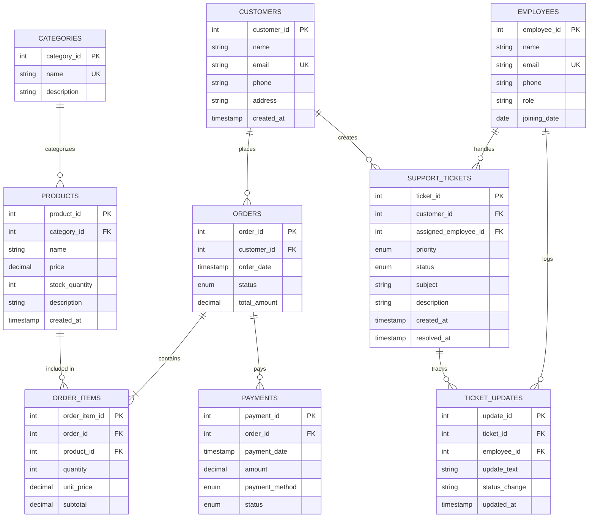

# Customer Relationship Management (CRM) System

A console-based **Customer Relationship Management (CRM) System** written in **C++17** with a **MySQL 8.0** backend. It uses a three-layer architecture (UI, Services, Repositories), ACID transactions for order processing, and dual queues (`std::priority_queue` + `std::queue`) for support ticket triage.

---

## Demo

Follow a ₹2,950 order from checkout through cancellation, then see how the CRM assigns a critical support ticket and reports sales:

https://github.com/AnKit1840/cpp-mysql-crm/raw/main/demo/crm-demo.mp4

---

## Features

- **Customer Management:** Add, update, search (by ID, name, or email), delete (with referential integrity checks), and view order/ticket history.
- **Employee Management:** Manage support staff profiles, assign tickets, and monitor active vs. resolved ticket workload.
- **Product & Inventory:** Manage catalogue items by category (`Kitchenware`, `Home Appliances`, `Handloom`, `Stationery`), update pricing/stock, and view low-stock alerts (`<= 10` units).
- **Orders & ACID Transactions:** Place multi-product orders with automatic stock deduction and payment logging wrapped in a RAII `TransactionGuard` (auto-rollback on failure or insufficient stock). Cancel orders to restore stock and mark payments as `REFUNDED`.
- **Support Ticket Triage:** `CRITICAL` and `HIGH` tickets are routed through a `std::priority_queue` (with FIFO tie-breaking by ticket ID), while `NORMAL` and `LOW` tickets use a standard `std::queue`, synced with MySQL and logged in `ticket_updates`.
- **Sales & Operations Analytics:** Executive revenue summary & AOV, monthly trends, top 5 customers, best-selling products, employee workload, and ticket severity breakdown (queries in `sql/queries.sql`).

---

## Tech Stack

- **Language:** C++17 (`std::unique_ptr`, `std::optional`, `<queue>`, `<unordered_set>`)
- **Database:** MySQL Server 8.0+ (InnoDB) via the MySQL C Client API (`libmysql`)
- **Build:** `g++` (MinGW-w64 64-bit) with `build.bat`

---

## Architecture

```
┌────────────────────────────────────────────────────────────────────────┐
│                      PRESENTATION LAYER (Layer 1)                      │
│   MenuUI, ConsoleUtils (CLI input validation, formatted tables)        │
└───────────────────────────────────┬────────────────────────────────────┘
                                    │
┌───────────────────────────────────▼────────────────────────────────────┐
│                     BUSINESS LOGIC LAYER (Layer 2)                     │
│   CustomerService, EmployeeService, ProductService, OrderService       │
│   TicketManager (priority_queue + queue), AnalyticsService             │
└───────────────────────────────────┬────────────────────────────────────┘
                                    │
┌───────────────────────────────────▼────────────────────────────────────┐
│                      DATA ACCESS LAYER (Layer 3)                       │
│   DatabaseManager (connection & TransactionGuard), *Repository classes │
└───────────────────────────────────┬────────────────────────────────────┘
                                    │
┌───────────────────────────────────▼────────────────────────────────────┐
│                            MySQL (crm_db)                              │
│   9 InnoDB tables (3NF schema with foreign keys and indexes)           │
└────────────────────────────────────────────────────────────────────────┘
```

---

## Database Schema (ER Diagram)



---

## Project Structure

```
├── build.bat                   # Windows build script (g++ C++17)
├── config/
│   └── db_config.example.ini   # Database configuration template
├── sql/
│   ├── schema.sql              # 9-table MySQL schema
│   ├── seed.sql                # Sample dataset
│   └── queries.sql             # Analytical SQL queries
├── include/
│   ├── database/               # ConfigLoader, DatabaseManager
│   ├── models/                 # User, Customer, Employee, Product, Order, Ticket...
│   ├── repositories/           # Data access layer
│   ├── services/               # Business logic layer
│   └── ui/                     # ConsoleUtils, MenuUI
├── src/                        # Implementations & main.cpp
└── tests/
    └── test_runner.cpp         # Automated unit & DB integration tests
```

---

## Setup & Build (Windows)

### 1. Initialize the Database
Run the schema and seed scripts in MySQL Workbench or the MySQL CLI:
```sql
SOURCE sql/schema.sql;
SOURCE sql/seed.sql;
```

### 2. Configure Credentials
Copy `config/db_config.example.ini` to `config/db_config.ini` and set your MySQL password:
```ini
[database]
host = 127.0.0.1
port = 3306
database = crm_db
user = root
password = your_mysql_password
```

### 3. Build
Requires a 64-bit `g++` (MinGW-w64) and MySQL Server 8.0+ (override path with `MYSQL_DIR` if needed):
```cmd
build.bat
```
This builds `bin\crm_system.exe` and `bin\crm_tests.exe` and copies the required MySQL/MinGW runtime DLLs into `bin\`.

### 4. Run Tests & Application
```cmd
bin\crm_tests.exe
bin\crm_system.exe
```

---

